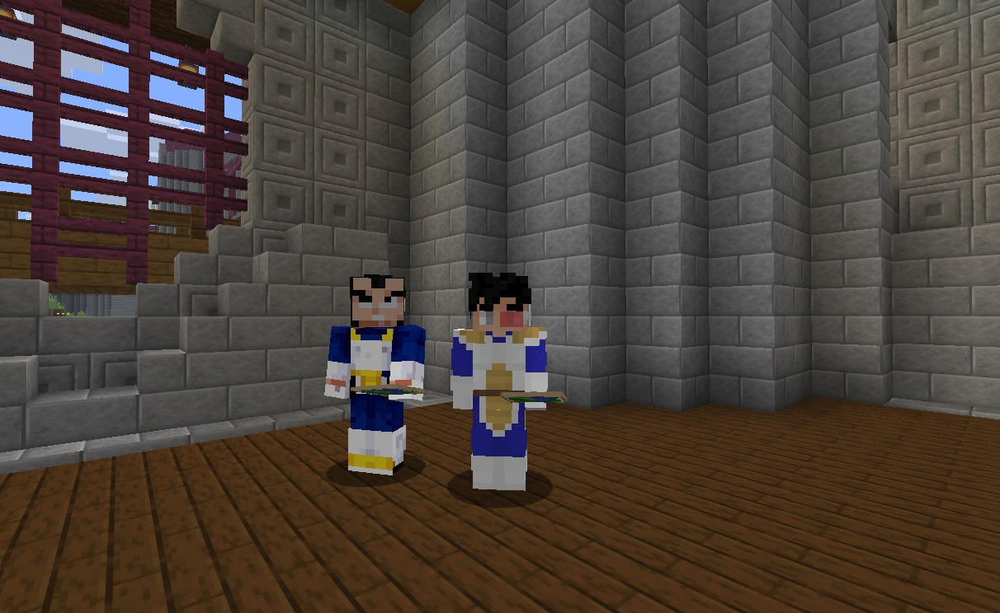
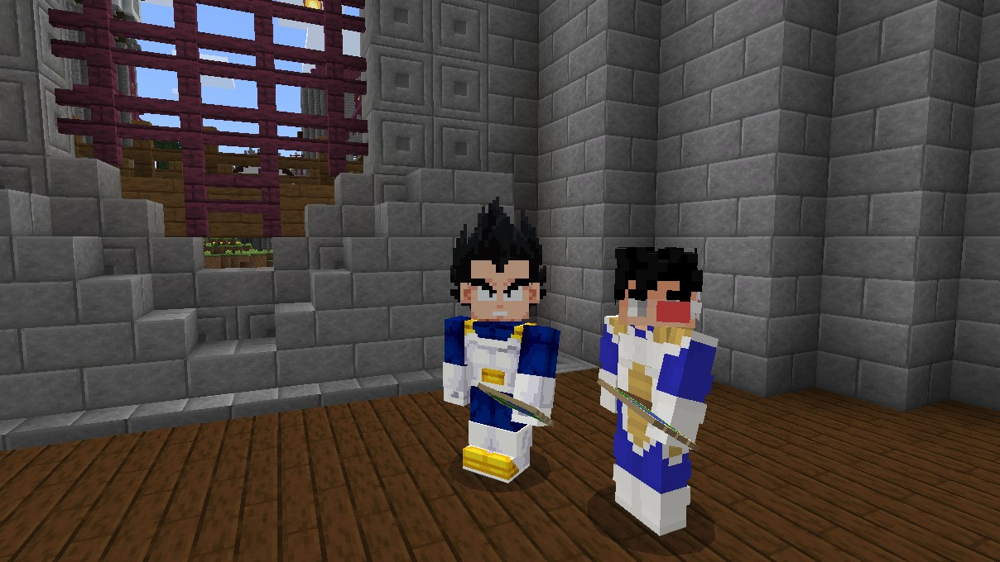

# PersonaSkins

A Paper plugin that shows Bedrock players' 3D skins to Java players, hair and
all.

| Seen from Java | Seen from Bedrock |
|---|---|
|  |  |

The same Bedrock player (on the left) on the same server. Java shows the PersonaSkins render:
the model's hair, flattened onto the head. Bedrock shows the original model.

Bedrock players join a Java server through [Geyser](https://geysermc.org) and
[Floodgate](https://github.com/GeyserMC/Floodgate), and Floodgate gives Java
players a Java version of each Bedrock skin. A Java skin is a flat texture on a
fixed model, though, and a Bedrock skin can be a model of its own: a persona
(Character Creator) skin's hair, hats, hoods and beards are separate 3D pieces.
Floodgate's conversion copies the parts of the standard player model and drops
the rest, so a persona with hair shows on Java with a bald head.

PersonaSkins draws the whole model instead:

1. When a Bedrock player joins with a persona skin, or any skin whose geometry
   goes beyond the standard model, it reads the skin's texture and geometry from
   Geyser.
2. It renders them onto both layers of a 64x64 Java skin. Every texel of the
   Java model is a point on one face of a body part's box; from there a ray is
   cast inward through the Bedrock model. The first opaque surface standing out
   from the box becomes that texel of the outer layer (where hair goes), and the
   first surface at or under the box becomes the base layer. From each of the
   six sides, the Java skin then looks as the Bedrock model does, with what
   stood out pressed onto the outer layer.
3. It has [MineSkin](https://mineskin.org) sign the image. Java clients only
   show another player's skin from a property signed by Mojang, so an image has
   to be worn once by a real account; MineSkin does that.
4. It applies the result in place of Floodgate's, now and every time Floodgate
   would apply its own.
5. Bedrock players watching keep seeing the real 3D skin: Geyser would draw
   them from the flattened Java one, so PersonaSkins hands Geyser the
   player's own texture and geometry back for Bedrock viewers.

Results are cached by the Bedrock skin's hash in `plugins/PersonaSkins/cache/`,
so a skin is rendered and uploaded once; anyone joining with the same skin
later gets it straight away.

It is a best effort. Anything further than the outer layer from the body (a
large hat brim, long hair past the shoulders) is still flattened onto the
nearest face, and the outer layer cannot show what a model has under an
overhang.

## Install

Paper 26.3+ on Java 25, with Geyser-Spigot and Floodgate on the same server:
put the jar from the [releases](../../releases) in `plugins/` and restart.

The [installation guide](docs/installation.md) covers the rest: running it in
a container, configuration, MineSkin keys, what Java and Bedrock players each
see, the `/personaskins` commands for checking a render, and troubleshooting.

## Building

```sh
./gradlew build
```

The jar is in `build/libs/`. The tests check that a standard skin passes
through the renderer unchanged, texel for texel, and that hair above the head
lands on the outer layer; they write their renders to `build/test-renders/`.

Pushing a tag `v1.2.3` builds version 1.2.3 and attaches the jar to a GitHub
release.

## References

Written from reading these projects' source; no code is copied from them.

- [GeyserMC/Geyser](https://github.com/GeyserMC/Geyser): `BedrockClientData`
  for what a Bedrock client sends with its skin and how Geyser decodes it, and
  `FloodgateSkinUploader` for how skins reach the global API.
- [GeyserMC/Floodgate](https://github.com/GeyserMC/Floodgate): `SkinApplyEvent`
  and `SpigotSkinApplier`, for when Floodgate applies a skin and how to
  replace it.
- [GeyserMC/global_api](https://github.com/GeyserMC/global_api): the skin
  converter in `native/skins` (Rust), which showed which bones Floodgate's
  conversion keeps and that poly-mesh UVs count up from the bottom.
- [InventivetalentDev/MineskinClient](https://github.com/InventivetalentDev/MineskinClient):
  MineSkin's v2 `generate` request and response, and its rate-limit fields.
- [Blockbench](https://github.com/JannisX11/blockbench): the conventions of
  Bedrock geometry files, such as the box-UV layout and how rotations are
  written.
- [PaperMC/Paper](https://github.com/PaperMC/Paper): the player profile API
  used to set the skin.

## License

[MIT](LICENSE)
